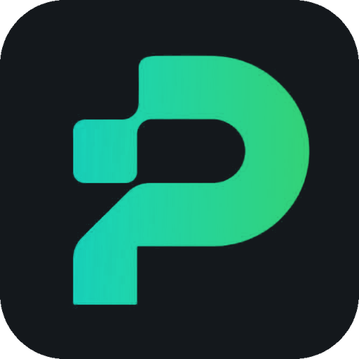

<p align="center"></p>

# PAD — Personal Administration Desk

**PAD** — локальное Windows-приложение для фрилансера или небольшой студии: проекты и заказы, задачи, финансы, календарь, база знаний, шаблоны и резервные копии в одном месте. Без аккаунтов, облака и подписок: данные хранятся на вашем компьютере.

[](https://dotnet.microsoft.com/)
[](#установка)
[](../../actions)

## Почему PAD

- **Локально и приватно.** SQLite-база лежит в `%LOCALAPPDATA%\PAD\pad.db`; интернет и аккаунт не нужны, данные никуда не отправляются.
- **Деньги без ошибок округления.** Суммы хранятся в целых минорных единицах (копейках/центах), а не в `float`/`double`.
- **Сдача ≠ оплата.** Проект можно сдать заказчику и ещё не получить деньги: жизненный цикл и оплата независимы.
- **Заработок — только фактически полученные платежи** по дате получения; договорная стоимость заказа никогда не считается доходом.
- **Мультивалютность без выдуманных курсов.** Итоги группируются по валюте; пересчёт — только по ручному курсу, если вы его задали.

## Возможности

### Проекты и заказы

- Стоимость, валюта, дедлайн, категория, заказчик, приоритет, цель, описание.
- Жизненный цикл: планируется → ожидает начала → в работе → на паузе → на проверке → сдан заказчику → завершён / отменён.
- Платежи: предоплата, промежуточные, финальные, дополнительные, возвраты; статус оплаты вычисляется из платежей.
- Фиксация сдачи отдельно от оплаты; повторное открытие проекта сохраняет историю.
- Этапы проекта: список этапов со статусами и заметками.
- Архив проектов без удаления платежей и истории.
- Поиск по проектам, история изменения цены и статуса.

### Главная

- Счётчики проектов и задач, заработок по периодам.
- Кольцевая диаграмма заработка по категориям (цвет новой категории подбирается автоматически).
- Динамика по месяцам, ближайшие события и задачи, журнал активности.

### Финансы

- Средний чек, объём заказов, топ проектов, ожидаемые платежи со статусами (ожидается / скоро / просрочен / частично получен).
- Разные валюты не смешиваются.

### Задачи

- Приоритеты, сроки, привязка к проекту, фильтры (открытые, просроченные, выполненные, все).

### Календарь

- Сроки проектов, задачи и полученные платежи по дням.

### База знаний

- Заметки с тегами и поиском.

### Шаблоны

- Типовые проекты с набором задач, создание проекта в один клик.

### Поиск

- Глобальный поиск по проектам, задачам, заметкам и шаблонам.

### Профиль и настройки

- Имя, роль, описание, дата начала, аватарка (PNG/JPG/BMP).
- Тёмная и светлая темы.
- Резервные копии в ZIP (включая аватарку и файлы), восстановление с предварительным сохранением текущих данных.
- Проверка целостности базы, экспорт истории платежей в CSV.
- Ежедневная автокопия (хранятся последние 7).

## Приватность и хранение данных

| Что | Где |
|---|---|
| База данных | `%LOCALAPPDATA%\PAD\pad.db` |
| Файлы | `%LOCALAPPDATA%\PAD\files` |
| Резервные копии | `%LOCALAPPDATA%\PAD\backups` |
| Журнал ошибок | `%LOCALAPPDATA%\PAD\error.log` |

- SQLite в режиме WAL, `PRAGMA foreign_keys = ON`, `synchronous = FULL`.
- Интернет не используется, аккаунт не нужен.
- Перед миграцией создаётся автобэкап; восстановление выполняется через временную папку и атомарную подмену.

## Технологии

C# · .NET 8 · WPF (MVVM, CommunityToolkit.Mvvm) · SQLite · Entity Framework Core.  
Денежные суммы хранятся в целых минорных единицах, без чисел с плавающей запятой. Графики и диаграммы рисуются собственными контролами (`BarChart`, `DonutChart`).

## Архитектура

```
PAD/
├─ PAD.Domain/      # сущности, enum'ы, FinanceCalculator, ColorPalette
├─ PAD.Data/        # EF Core + SQLite, сервисы, бэкап, экспорт
├─ PAD.App/         # WPF, MVVM, темы, представления
├─ PAD.Tests/       # xUnit
├─ installer/       # Inno Setup
└─ .github/         # CI/CD
```

Ключевые решения:

1. **Деньги — `decimal` в домене, `long` (центы) в SQLite** через `ValueConverter`, чтобы `SUM` и сортировка в SQL были точными.
2. **Статус сдачи ≠ статус оплаты.** `Project.Status` и вычисляемый `PaymentStatus` независимы.
3. **Заработок = только `Payment` с `IsReceived = true`** по `ReceivedDate`.
4. **Возвраты** — платёж типа `Refund` с отрицательным вкладом.
5. **История** (`ProjectPriceHistory`, `ProjectStatusHistory`, `StageStatusHistory`) — append-only.
6. **Архив** — флаг `IsArchived`; платежи и аналитика учитываются независимо.
7. **Автосохранение** редакторов: debounce 800 мс + сохранение при потере фокуса и закрытии.

## Установка

Скачайте `PAD-Setup.exe` из раздела [Releases](../../releases) (или из **Actions → последний запуск → Artifacts**) и запустите. Либо возьмите переносимый `PAD.exe` — он не требует установки .NET.

Установщик создаёт ярлыки в меню «Пуск» и, по выбору, на рабочем столе. Установка идёт в профиль пользователя (`%LOCALAPPDATA%` не затрагивается).

## Сборка из исходников

Нужен .NET 8 SDK и Windows (WPF).

```bash
dotnet test PAD.Tests/PAD.Tests.csproj -c Release
dotnet publish PAD.App/PAD.App.csproj -c Release -r win-x64 --self-contained true \
  -p:PublishSingleFile=true -p:IncludeNativeLibrariesForSelfExtract=true -o publish
```

Сборка установщика (нужен Inno Setup 6):

```powershell
& "C:\Program Files (x86)\Inno Setup 6\ISCC.exe" installer\PAD.iss
```

Результат: `installer-out/PAD-Setup.exe` и `publish/PAD.exe`.

## Тесты

Проект `PAD.Tests` (xUnit) покрывает:

- финансы и `FinanceCalculator`;
- проекты и платежи;
- задачи и активность;
- базу знаний и шаблоны;
- дашборд и финансовую сводку;
- категории и диаграммы;
- резервные копии и восстановление.

Запуск: `dotnet test PAD.Tests/PAD.Tests.csproj -c Release`. Тесты не требуют Windows и могут выполняться в CI на Linux.

## CI/CD

GitHub Actions (`.github/workflows/build.yml`) на `push`/`pull_request`:

1. `dotnet test` (Release);
2. `dotnet publish` (self-contained, single-file);
3. сборка установщика через Inno Setup;
4. публикация артефактов `PAD-win-x64` и `PAD-Setup`.

При пуше тега `v*` создаётся GitHub Release с `PAD-Setup.exe` и `PAD.exe`.

## Статус и планы

**Версия 1.0.0.** Реализовано всё перечисленное выше.

В планах:

- канбан-доска проектов и задач;
- вложения к проектам и заметкам;
- уведомления и напоминания;
- расписания платежей;
- чек-листы в задачах;
- Markdown для заметок этапов;
- автоматические курсы валют;
- экспорт в XLSX.
```

Need check if "Установка идёт в профиль пользователя" accurate: Inno Setup PrivilegesRequired=lowest, DefaultDirName={autopf} which under Program Files? Actually {autopf} for lowest privileges maps to %LocalAppData%\Programs? Let's verify Inno Setup: {autopf} = Program Files or Program Files (x86) depending; with lowest privileges, maybe {userpf}? Hmm. Inno docs: {autopf} automatically Program Files (x86) on 64-bit? Actually for 64-bit installers, {autopf} = {pf64} if 64-bit mode. PrivilegesRequired=lowest may install to user profile? Not sure. Better avoid claim. Change to "Установщик не требует прав администратора." That's accurate (PrivilegesRequired=lowest). Let's adjust.

Also "экспорт в XLSX" planned; export service only CSV. Good.

Let's remove the installation directory claim. Use "Установщик работает без прав администратора." Good.

Let's write file.<|end|><|start|>(radix to=write<|channel|>analysis <|constrain|>xml<|message|><rfl:parameter name="content">
<p align="center"></p>

# PAD — Personal Administration Desk

**PAD** — локальное Windows-приложение для фрилансера или небольшой студии: проекты и заказы, задачи, финансы, календарь, база знаний, шаблоны и резервные копии в одном месте. Без аккаунтов, облака и подписок: данные хранятся на вашем компьютере.

[](https://dotnet.microsoft.com/)
[](#установка)
[](../../actions)

## Почему PAD

- **Локально и приватно.** SQLite-база лежит в `%LOCALAPPDATA%\PAD\pad.db`; интернет и аккаунт не нужны, данные никуда не отправляются.
- **Деньги без ошибок округления.** Суммы хранятся в целых минорных единицах (копейках/центах), а не в `float`/`double`.
- **Сдача ≠ оплата.** Проект можно сдать заказчику и ещё не получить деньги: жизненный цикл и оплата независимы.
- **Заработок — только фактически полученные платежи** по дате получения; договорная стоимость заказа никогда не считается доходом.
- **Мультивалютность без выдуманных курсов.** Итоги группируются по валюте; пересчёт — только по ручному курсу, если вы его задали.

## Возможности

### Проекты и заказы

- Стоимость, валюта, дедлайн, категория, заказчик, приоритет, цель, описание.
- Жизненный цикл: планируется → ожидает начала → в работе → на паузе → на проверке → сдан заказчику → завершён / отменён.
- Платежи: предоплата, промежуточные, финальные, дополнительные, возвраты; статус оплаты вычисляется из платежей.
- Фиксация сдачи отдельно от оплаты; повторное открытие проекта сохраняет историю.
- Этапы проекта: список этапов со статусами и заметками.
- Архив проектов без удаления платежей и истории.
- Поиск по проектам, история изменения цены и статуса.

### Главная

- Счётчики проектов и задач, заработок по периодам.
- Кольцевая диаграмма заработка по категориям (цвет новой категории подбирается автоматически).
- Динамика по месяцам, ближайшие события и задачи, журнал активности.

### Финансы

- Средний чек, объём заказов, топ проектов, ожидаемые платежи со статусами (ожидается / скоро / просрочен / частично получен).
- Разные валюты не смешиваются.

### Задачи

- Приоритеты, сроки, привязка к проекту, фильтры (открытые, просроченные, выполненные, все).

### Календарь

- Сроки проектов, задачи и полученные платежи по дням.

### База знаний

- Заметки с тегами и поиском.

### Шаблоны

- Типовые проекты с набором задач, создание проекта в один клик.

### Поиск

- Глобальный поиск по проектам, задачам, заметкам и шаблонам.

### Профиль и настройки

- Имя, роль, описание, дата начала, аватарка (PNG/JPG/BMP).
- Тёмная и светлая темы.
- Резервные копии в ZIP (включая аватарку и файлы), восстановление с предварительным сохранением текущих данных.
- Проверка целостности базы, экспорт истории платежей в CSV.
- Ежедневная автокопия (хранятся последние 7).

## Приватность и хранение данных

| Что | Где |
|---|---|
| База данных | `%LOCALAPPDATA%\PAD\pad.db` |
| Файлы | `%LOCALAPPDATA%\PAD\files` |
| Резервные копии | `%LOCALAPPDATA%\PAD\backups` |
| Журнал ошибок | `%LOCALAPPDATA%\PAD\error.log` |

- SQLite в режиме WAL, `PRAGMA foreign_keys = ON`, `synchronous = FULL`.
- Интернет не используется, аккаунт не нужен.
- Перед миграцией создаётся автобэкап; восстановление выполняется через временную папку и атомарную подмену.

## Технологии

C# · .NET 8 · WPF (MVVM, CommunityToolkit.Mvvm) · SQLite · Entity Framework Core.  
Денежные суммы хранятся в целых минорных единицах, без чисел с плавающей запятой. Графики и диаграммы рисуются собственными контролами (`BarChart`, `DonutChart`).

## Архитектура

```
PAD/
├─ PAD.Domain/      # сущности, enum'ы, FinanceCalculator, ColorPalette
├─ PAD.Data/        # EF Core + SQLite, сервисы, бэкап, экспорт
├─ PAD.App/         # WPF, MVVM, темы, представления
├─ PAD.Tests/       # xUnit
├─ installer/       # Inno Setup
└─ .github/         # CI/CD
```

Ключевые решения:

1. **Деньги — `decimal` в домене, `long` (центы) в SQLite** через `ValueConverter`, чтобы `SUM` и сортировка в SQL были точными.
2. **Статус сдачи ≠ статус оплаты.** `Project.Status` и вычисляемый `PaymentStatus` независимы.
3. **Заработок = только `Payment` с `IsReceived = true`** по `ReceivedDate`.
4. **Возвраты** — платёж типа `Refund` с отрицательным вкладом.
5. **История** (`ProjectPriceHistory`, `ProjectStatusHistory`, `StageStatusHistory`) — append-only.
6. **Архив** — флаг `IsArchived`; платежи и аналитика учитываются независимо.
7. **Автосохранение** редакторов: debounce 800 мс + сохранение при потере фокуса и закрытии.

## Установка

Скачайте `PAD-Setup.exe` из раздела [Releases](../../releases) (или из **Actions → последний запуск → Artifacts**) и запустите. Либо возьмите переносимый `PAD.exe` — он не требует установки .NET.

Установщик работает без прав администратора и создаёт ярлыки в меню «Пуск» и, по выбору, на рабочем столе.

## Сборка из исходников

Нужен .NET 8 SDK и Windows (WPF).

```bash
dotnet test PAD.Tests/PAD.Tests.csproj -c Release
dotnet publish PAD.App/PAD.App.csproj -c Release -r win-x64 --self-contained true \
  -p:PublishSingleFile=true -p:IncludeNativeLibrariesForSelfExtract=true -o publish
```

Сборка установщика (нужен Inno Setup 6):

```powershell
& "C:\Program Files (x86)\Inno Setup 6\ISCC.exe" installer\PAD.iss
```

Результат: `installer-out/PAD-Setup.exe` и `publish/PAD.exe`.

## Тесты

Проект `PAD.Tests` (xUnit) покрывает:

- финансы и `FinanceCalculator`;
- проекты и платежи;
- задачи и активность;
- базу знаний и шаблоны;
- дашборд и финансовую сводку;
- категории и диаграммы;
- резервные копии и восстановление.

Запуск: `dotnet test PAD.Tests/PAD.Tests.csproj -c Release`. Тесты не требуют Windows и могут выполняться в CI на Linux.

## CI/CD

GitHub Actions (`.github/workflows/build.yml`) на `push`/`pull_request`:

1. `dotnet test` (Release);
2. `dotnet publish` (self-contained, single-file);
3. сборка установщика через Inno Setup;
4. публикация артефактов `PAD-win-x64` и `PAD-Setup`.

При пуше тега `v*` создаётся GitHub Release с `PAD-Setup.exe` и `PAD.exe`.

## Статус и планы

**Версия 1.0.0.** Реализовано всё перечисленное выше.

В планах:

- канбан-доска проектов и задач;
- вложения к проектам и заметкам;
- уведомления и напоминания;
- расписания платежей;
- чек-листы в задачах;
- Markdown для заметок этапов;
- автоматические курсы валют;
- экспорт в XLSX.
